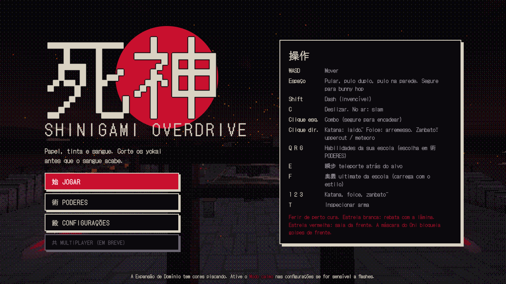

# 死神 Shinigami Overdrive

FPS hack and slash para navegador, rápido e meio psicodélico, inspirado em ULTRAKILL e Dimenshot. Você joga com armas brancas de anime (katana, foice e zanbatō), escolhe uma escola de poder e enfrenta ondas de yokai num templo que vai sendo destruído durante a luta.



Roda direto no navegador, sem instalar nada e sem build.

## Destaques

- **Movimentação estilo Quake** escrita do zero: bunny hop, air strafe, dash, pulo duplo, pulo na parede e slide.
- **3 armas** com combos próprios e um golpe especial cada.
- **20 escolas de poder, 80 habilidades**, cada uma com mecânica, efeito visual, gesto da mão e som próprios.
- **Efeitos de status que interagem**: fogo em inimigo congelado vira vapor e causa dano extra, por exemplo.
- **Cenário destrutível**: lanternas, muros, pilares, torii e pontes quebram, e impactos fortes abrem crateras de verdade no chão.
- **Ranking de estilo** (D até SSS) e chefe a cada 5 ondas.
- **Simulação separada da renderização**: a lógica do jogo roda no navegador e no Node, o que deixa a base pronta para multiplayer.
- **Testes automatizados sem navegador** para simulação, movimento, mapa, destruição e habilidades.
- Música sintetizada em tempo real na escala hirajoshi e **modo calmo** para quem é sensível a flashes.

## Como jogar

- **Mais fácil:** abra o `index.html` com dois cliques.
- **Arquivo único:** `node tools/build.js` gera `dist/shinigami-overdrive.html`, que dá para mandar pra qualquer pessoa.
- **Servidor local:** `node tools/serve.js` e abra `http://localhost:8080`.

Clique em JOGAR. O mouse é capturado e o Esc pausa.

## Controles

| Tecla | Ação |
|---|---|
| WASD | Mover |
| Espaço | Pulo, pulo duplo, pulo na parede (segure para bunny hop) |
| Shift | Dash (3 cargas, invencível durante o dash) |
| C | Deslizar. No ar: slam no chão |
| Clique esquerdo | Combo da arma |
| Clique direito | Golpe especial |
| Q, R, G | Habilidades da escola escolhida |
| E | Teleporte atrás do inimigo na mira (próximo golpe é crítico) |
| F | Ultimate da escola |
| 1 2 3 / roda | Trocar arma |
| T | Inspecionar arma |

## Armas

| Arma | Combo | Especial |
|---|---|---|
| 村雨 Murasame (katana) | 4 golpes rápidos, com uppercut que lança | **Iaidō:** carrega e atravessa a tela cortando tudo no caminho |
| 死神 Shinigami (foice) | Varreduras largas e giro multi-hit | **Bumerangue:** arremessa a foice, que vai e volta |
| 斬馬刀 Zanbatō | Golpes lentos e pesados | **No chão:** uppercut. **No ar:** meteoro que explode no chão |

## Escolas de poder

Espadas Almas, Teleporte, Explosão Demoníaca, Invocação de Demônios, Manipulação de Sangue, Escudo de Energia, Meteoro, Corpo de Fogo, Raio de Plasma, Congelamento, Gravidade, Rajada de Balas, Lança de Energia, Clones Sombrios, Vento Cortante, Regeneração, Trovão, Escuridão, Lâminas do Caos e Domínio Elemental.

Cada escola tem 3 habilidades (Q, R, G) e uma ultimate (F). A escolha é feita no menu 術 PODERES.

## Inimigos

| Inimigo | Papel |
|---|---|
| Lacaio | Chega em bando |
| Mago | Atira orbes rebatíveis e invoca lacaios |
| Ladino | Mergulha do alto e desvia de golpes |
| Guardião | Bloqueia de frente e cria ondas de choque |
| 阿修羅 Ashura (chefe) | Anel de orbes, lanças teleguiadas e laser giratório |

Regras de sobrevivência: causar dano de perto cura, projéteis rosa/dourados podem ser rebatidos com a lâmina e variar os golpes aumenta o rank.

## Testes

```bash
npm test                     # todos os testes
node tools/simtest.js 120 4  # 120 s de partida com 4 jogadores-robô
node tools/movetest.js       # física de movimento (air strafe, bunny hop)
node tools/maptest.js        # rotas do mapa
node tools/destructtest.js   # destruição do cenário
```

## Estrutura

```
index.html, styles.css   Página, HUD e menus
src/core/                Matemática, RNG, constantes e input
src/sim/                 Simulação pura (navegador e Node), escolas e habilidades
src/net/                 Sessão local (ponto de troca para o online)
src/render/              Shaders, efeitos, armas e braços em primeira pessoa (IK)
src/audio/               Música sintetizada e efeitos sonoros
src/ui/                  HUD e ícones
tools/                   Testes, build, servidor local e pipeline de assets
docs/MULTIPLAYER.md      Plano do multiplayer
```

## Tecnologias

JavaScript puro, Three.js (r128), shaders GLSL, Web Audio API e scripts Python no Blender para rig e animação dos inimigos.

## Créditos

- Design de armas, inimigos e poderes: fichas de arte próprias. Os modelos 3D dos inimigos foram feitos a partir delas e rigados/animados no Blender.
- Braços em primeira pessoa: "Rigged Fps Arms" by J-Toastie via [Poly Pizza](https://poly.pizza) (CC BY 3.0), recoloridos e animados por IK.
- Three.js (MIT).
- Sons: gravações CC0 do [Kenney.nl](https://kenney.nl) e do [Freesound](https://freesound.org). A lista completa está em `assets/sounds/CREDITS.md`.
- O modelo de movimento é inspirado no do Quake (GPL), mas o código foi reescrito do zero.
